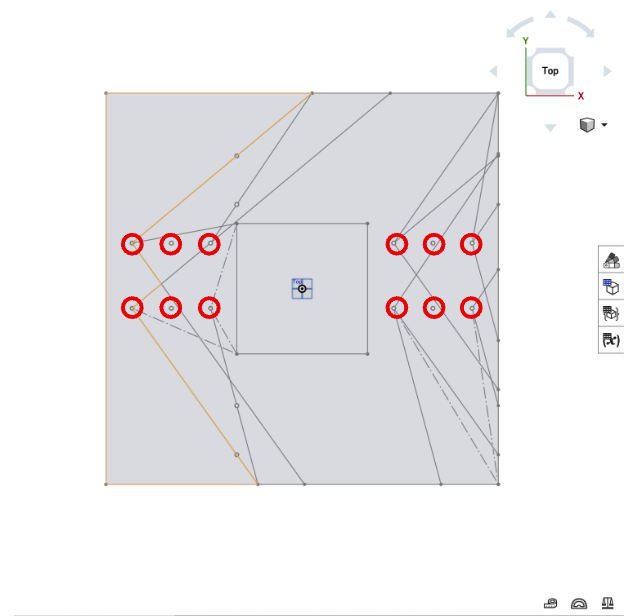
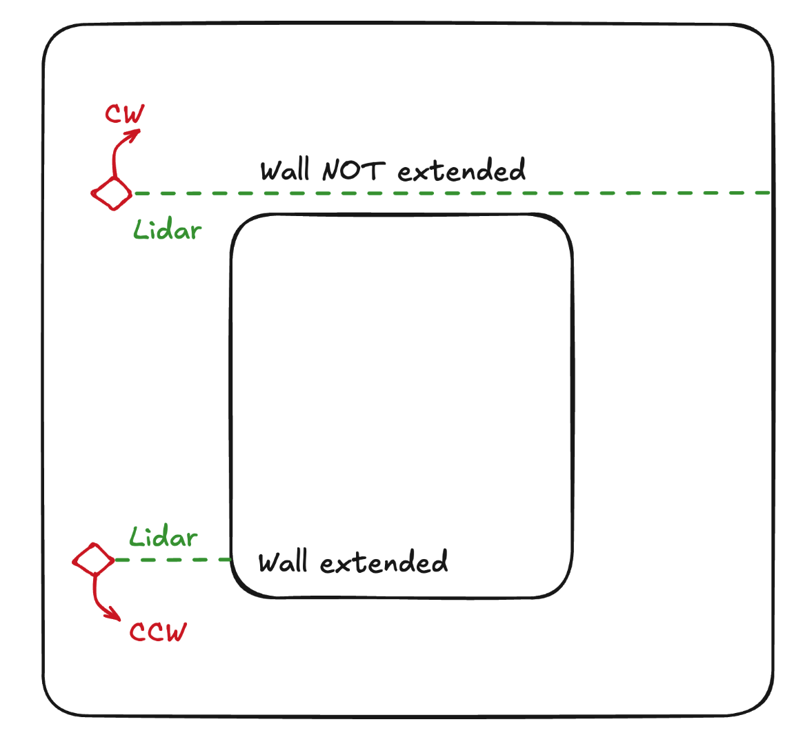
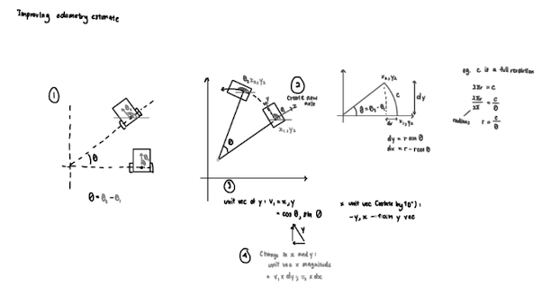
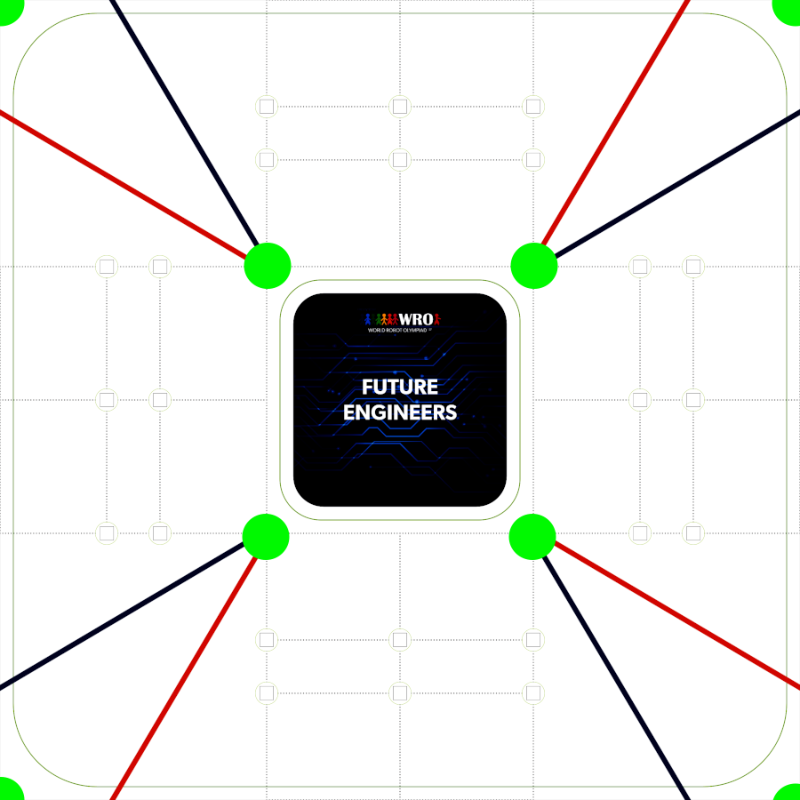
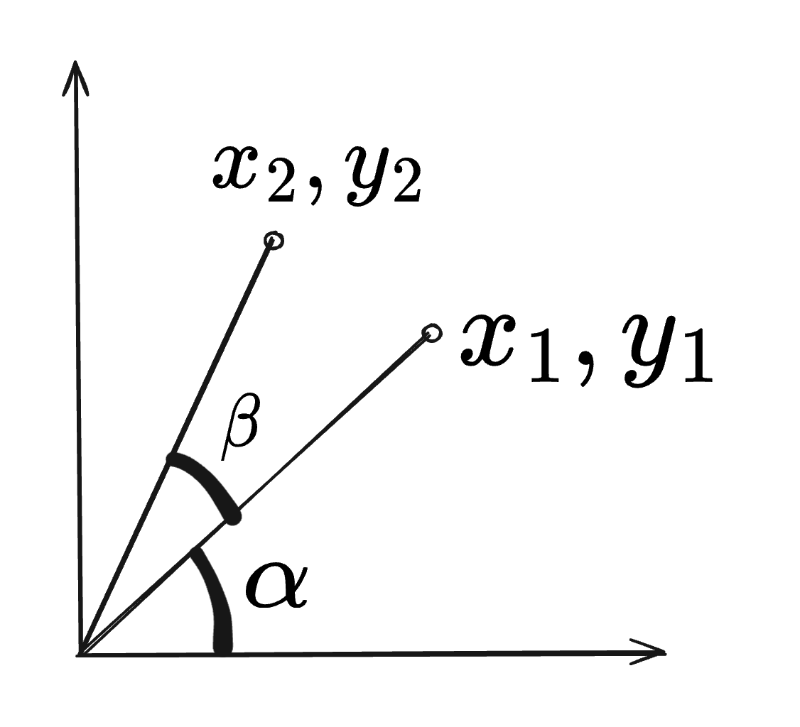
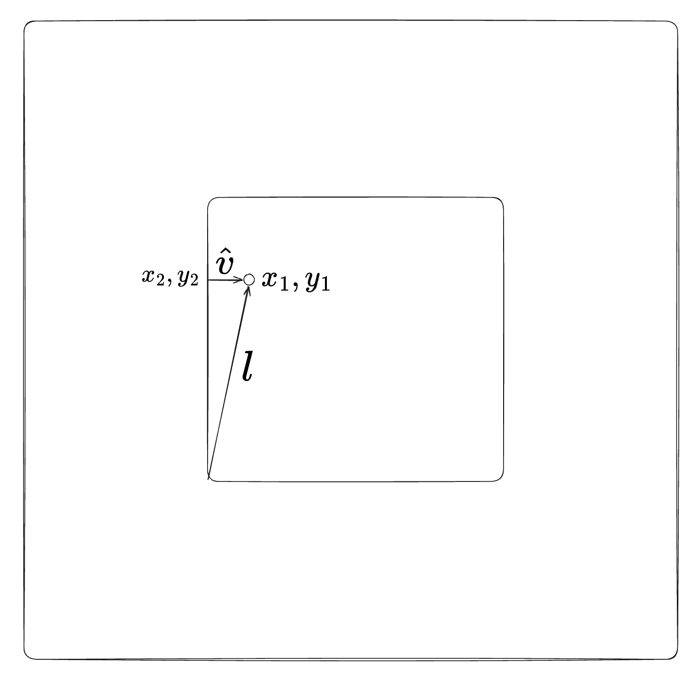
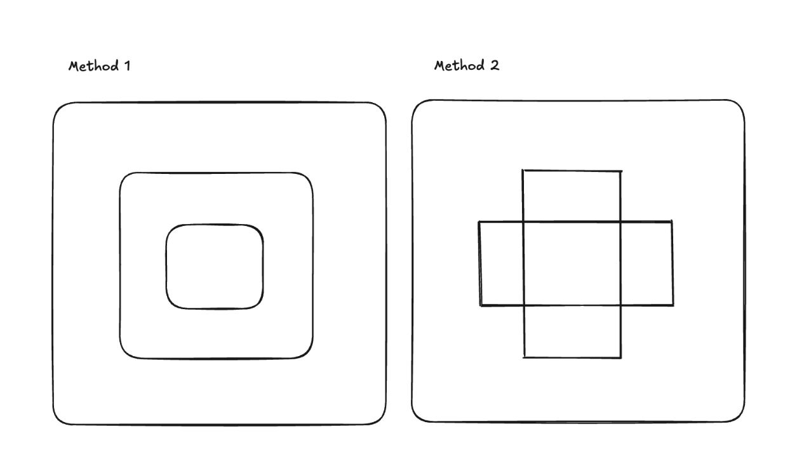
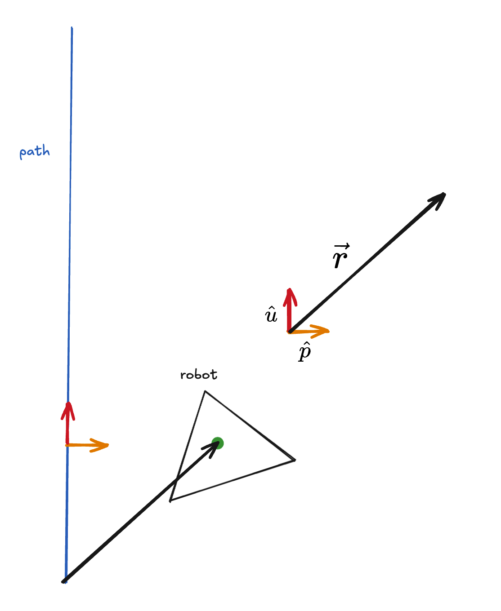
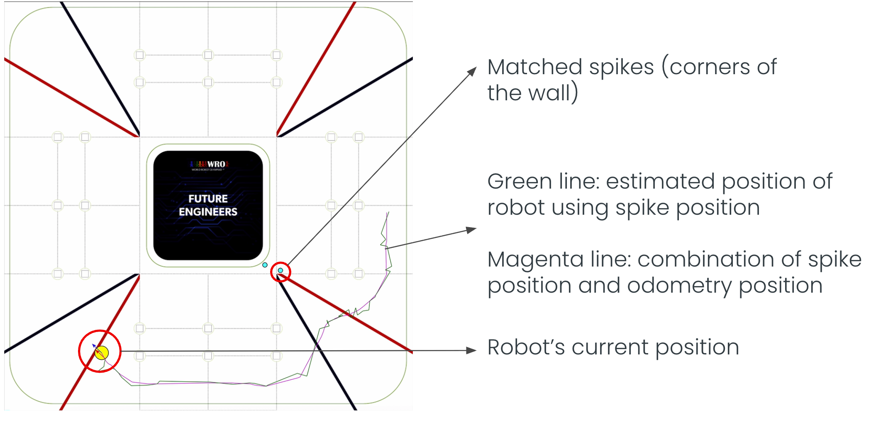

# Software Documentation 

## General Approach 

Both challenges are solved using non-”state machine” approaches because most sections of the
programme — which is mainly getting out of parking, determining initial position, navigating through playfield and parking — happen sequentially, never looping or switching between each other.

Additionally, throughout most of the programme, we have a non-blocking loop to constantly keep track of and update the robot’s pose by reading from the gyro, lidar and encoder sensors. Here is a breakdown of the loop:
1. Read [sensors](#sensor-libraries)
2. Estimating pose using [encoder](#encoder---ab-hall-effect-encoder) and [gyro](#gyro---mpu-6050) through [odometry](#odometry):
3. [Localisation](#localisation) using [Iterative Closest Points](#iterative-closest-point) (previously [Spike Landmark](#spike-landmark)) on LiDAR readings before merging both the odometry pose and localised pose using a [complementary filter](#complementary-filter)
4. [Navigating](#path-following) using the new merged pose 
5. Controlling servos and motors

## Code Structure

In 2025, our programme was much messier because of the way we switched between open and
obstacle modes. Specifically, we turned large sections of the programme into functions to import to the main file, where we would check the duration of the button press to determine which functions to run. Moreover, much of the main code could have been turned into individual functions, on top of the fact that the way we categorised the functions were ambiguous and clear, such that certain functions could have fit into more than one library / module. It is why in 2026, we completely refactored the code:

### Open

initialise_hardware (initialise_hardware.py)
gyro
lidar
encoder
motors

wait for button press

find initial position (initialise_pos.py)
read lidar
calculate initial pos

intialise_telemetry (telemetry.py)
initialise network connection

first path while True:
If width is 1000, take path with x = 500
elif width is 600, take path with x = 300
check while moving
if east > some dist:
confirm pose
break
elif west > some dist:
confirm pose
break

main while True:
read sensors (sensors.py)
gyro
lidar
encoder

estimate position (odometry.py)
localise - lidar (spike_localisation.py, point_cloud_localisation.py) - same functions, input (estimate_pos,
lidar_readings) and output (localised_pos)
merge estimate_pos and localised_pos (filter.py)
follow paths (navigation.py)
if end of a path:
check spike position to check if next wall is extended / aim at a certain point to check distance
if at ending position:
break
stop

### obstacle

initialise_hardware (initialise_hardware.py)
gyro
lidar
encoder
motors

wait for button press

find initial position (initialise_pos.py)
read lidar
calculate initial pos
front dist > back dist (clockwise); back_dist > front_dist (CCW)
if there are invalid readings (check with a range)
use only the valid reading

intialise_telemetry (telemetry.py)
initialise network connection

if obstacle in front:
move back

main while True:
read sensors (sensors.py)
gyro

lidar
encoder

estimate position -- odometry using encoder and gyro (odometry.py)
localise - lidar (spike_localisation.py, point_cloud_localisation.py) - same functions, input (estimate_pos,
lidar_readings) and output (localised_pos)
merge estimate_pos and localised_pos (filter.py)
follow paths (navigation.py)
if end of a path:
check camera for obstacle
if at ending position:
break

parking

stop

### Common Sections under both Open and Obstacle challenge 
Under the initialisation stage are functions for starting up the sensors and finding the robot’s position / direction. For easy reference to the sensors and up to date data, we put all the sensors into an object called sensors and their readings into an object called sensor_readings. Afterwards, we moved on to the main loop, which consists of the non-blocking loop. 

### Obstacle-specific programme
*Determining initial position* 
The robot will determine its direction (clockwise or counterclockwise) by getting the front, rear and side distances because the initial position is generally fixed. It will check if an obstacle is in front of it before moving back.

*Main run: avoiding obstacles*
In the main run, the robot will switch between two fixed sets of paths, an outer and inner lane. Depending on the colour of the blocks in front, it will switch between the two paths to follow. For example, if the robot is moving clockwise, detecting a red block will cause it to follow the inner paths, and vice versa for the green blocks. This will switch if the robot is moving counterclockwise. 

We also implemented camera tracking such that the camera follows the colour of the obstacle two sections ahead which ensures that the robot never misses the obstacle. In 2025, a major issue we had is that because our robot was larger and the field of vision of the robot was wider, we had to keep readjusting our paths so that the robot would be facing the obstacles directly to ensure that we did not miss it. As a result, we had to make so many adjustments to our paths: on the one hand, we had to ensure the obstacles fall within the robot’s field of vision; on the other hand, the robot is unable to make sharp turns so it needs enough space to steer. Now, with the camera tracking, we only have to focus on the robot’s steering limits when creating the path as the camera will also follow the obstacle that is 2 paths ahead of the current path. 

*Parking*
To get into the exact position at the start of parking, the robot repeatedly moves back and forth until the x, y values of the robot are within a certain range. Subsequently, the robot executes three turns before shifting back and forth again to wiggle itself into the parking area until its distance from the outer vertical wall is less than 20cm. 

### Open-specific programme
*Determining initial position*
Our final approach was for the robot to assume it is moving clockwise and travel the first path until it reaches the corner: this is where the robot will read the distances from the lidar sensor for the points (0mm, 2700mm) and (1000mm, 2700mm). If the distance for the left point is greater than the right point, it will deduce that it is moving counterclockwise and update its pose accordingly. The reason why we chose these points instead of measuring the left and right distances is because we encountered some issues with determining the sides at certain start positions. This was far more accurate than the approaches we used in 2025:



Used Onshape to visualise the possible positions (represented by dots which are circled in the above diagram)
Method 1:
- The lines represent the lidar readings from the corresponding angles from each starting position
- These lidar readings are used to determine if the bot is on the left or right side of the field
  - A threshold is set for the different lidar values of each starting position from each angle, and if the lidar reading falls between the threshold, the starting position is then determined
- Theory behind this: we only need to determine if the bot is on the left or right side of the field, as the top and bottom of the field is identical to the left and right, just in different orientation
- Pros:
  - The exact starting position can possibly be determined (starting position 1, 2, 3, 4, 5, or 6 from top left to bottom right)
- Cons:
  - Was not very reliable, struggled to determine the correct side near the inner corners
  - As the lidar readings needed to be at precise angles, it sometimes had inaccurate readings due to the angle being slightly off
  - This method would not work in the Open Challenge when the inner walls are extended outwards, causing the lidar readings to be different, resulting in the bot detecting an inaccurate side
Method 2: (used during 2025)
- By detecting the inner spikes (corners of the inner square of the field)
- Using the inner spike readings, we can determine which side of the field (left or right) the bot is starting in
- After determining the side of the starting position, the exact x and y position of the bot can be determined by using the lidar readings for every 90° (0°, 90°, 180°, 270°)
  - This is done by calculating the average of the lidar reading from opposing sides, e.g. ((3000 - front_distance) + rear_distance) / 2 -> this calculates the y value of our robot
  - A special case would be when the x value is calculated, where the x value differs depending on which side the bot is starting in
    - E.g. if the bot starts on the left, the x value would be 0 < x < 1000. If the bot starts on the right, the x value would be the same value as on the left side + 2000 (this is because the difference between the x value of the left and right starting position is always a constant of 2000cm)
- Pros:
  - Inner spikes are much easier to detect as compared to the outer spikes/walls from all 12 possible starting positions
  - This method works during the Open Challenge when the inner walls are extended, as the bot can still detect the inner spikes of the extended inner wall (as we have tested)
- Cons:
  - Still very unreliable as the robot might detect more spikes on the outer walls compared to the inner walls

*Main run*
The robot follows preplanned clockwise and counterclockwise inner and outer paths. The inner paths are 20cm away from the inner wall, while the outer paths are 70cm away from the inner wall. By default, it would take the outermost path. However, every time it finishes following a path, it will check the right (when clockwise) or left (when counterclockwise) distance of the lidar reading. If the distances are more than 80cm, it means the wall was not extended so it will switch to the inner path. 



Previously, we used a safe but unintelligent approach, where the robot only travelled the outer paths, meaning it was far less efficient and spent more time navigating through the playfield. 

## Sensor Libraries 

### LiDAR - COIN-D4 

We created our own library, because there weren't any python raspberrypi libraries, to receive data from the COIN-D4 LiDAR which uses the UART protocol. We used the serial package to open the serial port /dev/ttyS0 with the baud rate 230400. The scan frequency is roughly 10 rotations per second, 16 frames per rotation, 25 readings per frame, which sums up to 16 x 25 = 400 readings in 0.1 seconds. 

Everytime the input buffer is populated, we check if the first two characters match the data header '\xAA\x55' before retrieving the sample count (4th byte). Then, it reads until the pointer is at the final byte which would be: heading length + 3 bytes * sample_count. 

After checking if the checksum is valid, we parse the frame, assigning the appropriate angles with their distances. However, we noticed that we were losing data after plotting out the lidar points that were being used:
With buffering 
Bytes remaining in lidar - 344 → roughly 4 frames (85 bytes per frame)
Localisation count 48 
Loop count 141
Loops per second 141/ 5 = 28.2

1000 ms / 28.2 = 35.5 ms for each loop, which includes readings sensors, localisation with ICP and camera reading 

Without buffering 
Bytes remaining – 4095 / 85 = 48 frames 
Localisation count 10 
Loop count 142
Loop per second 142 / 5 = 28.4 

It means we were receiving 48 / 160 = 0.3 seconds worth of outdated data every 5 seconds. Thus, in the _parse_frame() function, we used a double buffering approach, which has two empty frames initially. This allows the programme to fill one scan while processing the previous completed scan. When start_angle wraps back to a smaller value, _parse_frame() switches measurement_ptr to the other list and clears that list. New samples go into the new active list, while the completed scan remains available in the other list, thereby avoiding clearing or overwriting data the programme may still be reading.


### Gyro - MPU-6050 

The gyro sensor uses the i2c protocol so initially, we used the pigpio library to receive data, but realised it was too slow and caused significant delays, so we switched to smbus. 

Additionally, we had to numerical integrate the z-axis gyroscope data over time to calculate the heading:
1. Read the raw angular velocity
2. Subtract the calibrated gyro offset value
3. Calculate the time passed since the previous reading
4. Take the sum of the current and previous z readings, multiply it by the time passed, and divide it by the sensitivity scale factor (131 * 2)

To find the calibrated gyro offset value, we also created a calibration function so that when we leave the robot as stationary, we can take the average of 500 measurements (which are suppose to be zero values) to find the z error. We also created functions to save the calibration as a txt file and load it. 

### Encoder - AB Hall-effect Encoder 

It is a type of quadrature encoder that measures rotation using the strength of the magnetic field in the x and y direction, and measures the positive/negative magnetic charge in those directionn. The true mechanical angle is then recovered by applying arctangent because the rotating magnet produces orthogonal sine and cosine magnetic field components. 

We used the pigpio library and programmed two callback functions to detect change in states for each channel A (Pin 5) and B (Pin 6)

```python 
cb1 = pi.callback(5, pigpio.RISING_EDGE, self.step_count)
cb2 = pi.callback(6, pigpio.EITHER_EDGE, self.drive_dir)
```

In the first callback, when channel A rises, it checks the state of channel B. If B is high, it is moving backward, whereas if B is low, it is moving in the opposite direction, forward. The second callback is constantly updating the state of channel B. 

Previously, we only read channel B when channel A goes from low to high. However, since the pipgio library would put that task in a cue, the time it takes for the raspberrypi to receive the signal the change in state of channel A is delayed, leading to an incorrect reading of the motor’s direction. Recording the change in states of both channels solves this issue by preserving the order of the changes in the states of the channels. 

Encoder calibration:
2025
1st attempt
- 1522.4mm – 5113 steps, 0.298mm  – 1 step 
2nd attempt
- 4670 mm – 15795 steps, 0.296mm – 1 step

2026
| Actual | Encoder | Time | Notes     |
| -----: | ------: | ---: | --------- |
|   1285 |    2705 |  5 s |           |
|   2005 |    4370 |  8 s | Discarded |
|   2075 |    4365 |  8 s |           |
|   2070 |    4357 |  8 s |           |

### Motor Driver - TA6586

The TA6586 is a monolithic, bidirectional H-bridge motor driver IC that uses sign-magnitude drive. In sign-magnitude control, the sign determines the motor's direction, while the magnitude determines how strongly the motor is driven. In the library, the sign of the speed argument selects the direction of rotation, while the absolute value of speed determines the PWM duty cycle and by extension the motor speed.

For positive speed, the GPIO pins 20, 21 are configured as such
```python
self.pi.set_PWM_dutycycle(21, 255-speed) # PWM controlled
self.pi.set_PWM_dutycycle(20, 255) # constantly high 
```
vice versa for negative speed
```python
self.pi.set_PWM_dutycycle(21, 255) # constantly high 
self.pi.set_PWM_dutycycle(20, 255+speed) # PWM controlled 
```

This allows for lower switching losses because fewer transistors switch simultaneously 

### Camera - Raspberry Pi Camera Module v2

We use the Raspberry Pi Camera Module with the picamera2 and cv2 library to identify the colour of the obstacles in front of the car. The colour detection works as follows:
1. Configuration:
    - Defines specific boundary values for green (Hue: 44—75, Saturation: 84—255, Value: 41—255) and red (Hue: 112—128, Saturation: 90—255, Value: 93—255).
    - Blob detector parameters are configured to target white blobs (blobColor = 255), enforce area constraints (minArea = 650, maxArea = 100000), and set geometric boundaries like circularity (minCircularity = 0.1) and convexity (minConvexity = 0.87).
2. Frame capture:
    - A default 640x480 frame is retrieved from the camera array using picam2.capture_array("main").
    - The frame array is cropped via frame[105:-1, 0:-1] to remove the top 105 pixels, preventing the camera from seeing over playfield walls.
    - The cropped image is passed through cv2.GaussianBlur(frame, (5,5), 0) to smoothen uneven surfaces and reduce high-frequency noise.
    - The smoothed image is converted from default BGR to HSV format using cv2.cvtColor(frame, cv2.COLOR_BGR2HSV).
3. Masking
    - Using cv2.inRange(), a binary mask is applied to the image, where the white parts of the image represent the areas that are within the tested thresholds for the green and red obstacles and everything else turns black
    - The detector.detect() function scans both masks independently to locate valid shapes, returning keypoints that contain coordinate and size data.
4. Filtering:
    - Run cv2.SimpleBlobDetector() on the binary masks. It rejects blobs that are smaller than 650 pixels to remove any noise
    - Iterates through all detected green and red keypoints to isolate the largest respective blob (g_largest_keypoint and r_largest_keypoint).
    - Decision Logic:
        i.   Returns None if neither color is detected.
        ii.   Returns "g" or "r" if only one color is found.
        iii.   Compares physical sizes (keypoint.size) if both are present, returning the character corresponding to the larger blob.

### Servos (Camera Swivel, Steering) - MG90

To calibrate the servos, we tested with different values from 500 to 2500 microseconds (µs) to find the centre, maximum and minimum. 

| Servo | Centre | Max, Min (in degrees) | 
| -----: | ------: | ---: | 
|   Camera |    1475 |  87 |
|   Steering |    1425 |  42 |

### I/O Interface (Button, LEDs)

In total, we have a button to start and stop the programme and three LEDS (red, yellow, green) to signal different messages for different challenges: open (red -- stationary, green -- running), obstacle (yellow -- stationary, green -- sees green obstacle, red -- sees red obstacle). 

## Localisation 

### Odometry 

We use the wheel rotation and gyro to estimate the robot's pose (position and heading) while it is running. 


- steer_in_dir(): steering (proportional control) 
- augment_path(), augment_paths(): Steering back to line 
    - Find path vector = (x2-x1) / (y2-y1)
    - Find distance of path
    - Find path vector in units
    - Find perpendicular path vector
    - Find path direction 
- dot(): dot product 
    - how far robot is off the path – drive_path()
    - how far robot has traveled along the path 
- drive_path(), drive_paths():

- estimate_pose():
    - First version: looked at the heading and assumed a straight path based on the heading 

    

    - Second version: treat the movement as an arc of a circle
        - Treat the centre of rotation as the origin, which means $\theta = \theta_{2} - \theta_{1}$, to find the local $d_x, d_y$
        $$d_y = r sin \theta, d_x = r cos \theta$$
        - Since $r = \frac{c}{\theta}$, in which c is the distance travelled
        $$d_y = \frac{c}{\theta} sin \theta, d_x = \frac{c}{\theta} cos \theta$$
        - To apply this back to the original axis, we take the x, y vectors of the "morphed" graph, (rotate y vector by $90^o$), before we multiply the unit vectors with the local $d_x, d_y$ to find the global $d_x, d_y$
        $$y^​′=(cosθ, sinθ​)$$
        $$x^′=(−sinθ, cosθ​)​$$
        $$d_X = x^​′ \times d_x, d_Y = y^​′ \times d_y$$

Afterwards, we integrate other localisation methods on top of using odometry, by using a complementary filter. 

### Spike Landmark 

Initially, we used the spike landmark method during the 2025 season of WRO, but we wanted to improve our localisation method so we have since shifted to the [Iterative Closest Point](#Iterative-Closest-Point) method. 

Essentially, the method identifies which lidar readings are spikes or points of interest, in our case corners which are noticeably further away than the adjacent readings. Afterwards, we calculate if there is any difference between the supposed and actual cartesian coordinate of the landmark to find the error. 

- Defined 8 landmarks: 4 inner corners, 4 outer corners, marked as green circles

- add_cartesian(): convert lidar readings into cartesian coordinates
- identify_spikes()  
	- the different between two lidar measurements adjacent to the centre measurement have to show a significant difference
	- filter out spikes within 250mm
- match_landmarks(): within 120mm, which we tested as the most optimal threshold 
- calc_position_error(), calc_angle_error(): according to the spikes matched, we calculate the total error accumulated for x, y and heading (angle of the spike from the robot) separeately before finding the average for each value and adding it to the odometry_pose 

However, this method only uses a few points out of the approximate 400 we get from the lidar in comparison to the [Iterative Closest Point](#Iterative-Closest-Point) method that makes full use of all the lidar readings. 

### Iterative Closest Point 

- augment_walls(): Define the 8 walls on the playfield, getting their path vector, path direction, unit path vector and perpendicular path vector which are values needed 
- add_cartesians(): same as the one used in the Spike Landmark 

**localise():**
Let's start by transforming 1 point on a cartesian plane. 



To handle the rotation, we can 

$$x_2 = R \cos(\alpha + \beta) = R [\cos(\alpha)\cos(\beta) - \sin(\alpha)\sin(\beta)]$$
$$y_2 = R \sin(\alpha + \beta) = R [\sin(\alpha)\cos(\beta) + \cos(\alpha)\sin(\beta)] $$

Substitute $$x_1 = R \cos(\alpha), y_1 = R \sin(\alpha)$$, 

$$x_2 = x_1\cos(\beta) - y_1\sin(\beta) $$
$$y_2 = y_1\cos(\beta) + x_1\sin(\beta) $$

Since the change in x, y and heading is going to small as the frequency of the Coin-D4 is 10 Hertz, we can linearize the functions, by taking their gradients near 0. 

$$ \cos(\beta) \approx 1, \sin(\beta) \approx \beta $$

$$ \therefore x_2 = x_1 - y_1(\beta), y_2 = y_1 + x_1(\beta) $$

Afterwards, we add translation as $T_x, T_y$

$$ x_2 = x_1 - y_1(\beta) + T_x, y_2 = y_1 + x_1(\beta) + T_y $$
$$ \therefore x_2 - x_1 = -y_1(\beta) + T_x, y_2 - y_1 = x_1(\beta) + T_y $$

When we put it in a matrix form, 

$$ \begin{bmatrix} 
-y_1 & 1 & 0 \\
x_1 & 0 & 1 
\end{bmatrix}
\begin{bmatrix} 
\theta \\
T_x \\
T_y
\end{bmatrix} = \begin{bmatrix} 
x_2 - x_1 \\
y_2 - y_1
\end{bmatrix}
$$

And we can add as many points as we want to the equation

$$ \begin{bmatrix} 
-y_1 & 1 & 0 \\
x_1 & 0 & 1 \\
\vdots & \vdots & \vdots
\end{bmatrix}\begin{bmatrix} 
\theta \\
T_x \\
T_y
\end{bmatrix} = \begin{bmatrix} 
x_2 - x_1 \\
y_2 - y_1 \\
\vdots
\end{bmatrix}
$$ 

To solve this $Ax = B$, we take the psuedoinverse of A multipled by B, $x = A^{-1} B$ which we calculate using the `numpy` library. 

Now that we have the transformation matrix, we need to identify which point on the wall does the lidar reading correspond to, in our case we find the shortest perpendicular distance between each wall and the reading. 



$dist = \hat{v} \cdot l$, in which $l$, is the vector of the lidar reading from the start of the wall. If it is a vertical wall, we only solve for the x-value and vice versa for a horizontal wall. 

We tested it with a set of fake data which started with the mini-sets contain that have far fewer readings, before moving on to [set 1](/point_cloud_test_sets/set1.txt) which has 360 points, closer to what we will expect in the acutal run. After debugging, we realised that it was able to get close to the actual pose with only one iteration. Additionally, we timed it and it took roughly 1/50th of a second, meaning it is able to keep up with the lidar which takes 10 readings every 1 second.

There were many bug fixes / improvements made to the ICP programme, including:
- Omitting the section for rotating the odometry position and only changing the x, y values by Tx and Ty. This would only work if the x, y values of the robot were close to the origin, which is why we observed that the x, y values became very far off when the robot was further away from the 0, 0 point. 
- Fixing the vertical wall matching 
- Added localise_iter() func to easily adjust the number of times ICP is applied, we found that after 2 iterations or even 1 iteration (if the current pose is not far off from the actual pose), the predicted values were already close to where the function converges

```bash 
[2519.9815226438686, 2782.166225377736, 14.07992247383642] # 1st iter
[2558.977006916372, 2578.8532799108843, 10.352319511258976] # 2nd iter
[2557.2214616516326, 2535.241481238653, 10.300720600786919] # so on and so forth
[2557.2218337089575, 2535.2418511534856, 10.300720660915843]
[2557.221833708957, 2535.241851153486, 10.300720660915838]
[2557.221833708957, 2535.2418511534856, 10.30072066091585]
[2557.221833708957, 2535.2418511534856, 10.300720660915845]
[2557.2218337089575, 2535.241851153485, 10.300720660915859]
[2557.221833708958, 2535.2418511534856, 10.300720660915852]
[2557.221833708957, 2535.2418511534856, 10.300720660915845]

current pose: [2300, 2800, 12]
actual pose: [2557.221145629883, 2535.240325927734, 10.297032712854872], point_cloud_pose: [2557.221833708957, 2535.2418511534856, 10.300720660915845]
```

- Added parking walls for obstacle challenge 
- Added extended inner walls for open challenge: we decided to draw them as nested squares instead of the cross shape on the right, because the cross shape has intersections which may cause some LiDAR points to be matched to the wrong walls. 



### Complementary Filter

It combines both the odometry pose and localisation pose by applying a weighing factor to each reading to blend both of their strengths. The odometry pose uses the gyroscope which provides smooth, fast and accurate short-term measurements, but drifts over time; in contrast, the localisation pose is derived using the LiDAR sensor readings which provides long-term reliable readings but are noisy and sensitive to sudden movements.

$\theta_{k+1} = \alpha(\theta_{k} + \omega \cdot \Delta t) + (1 - \alpha)\theta_{accel}$, where $\theta_{accel}$ is instead the angle calculated from the lidar readings. The advantages of using the complementary filter is that it is computationally lightweight compared to Kalman filters and can be easily tuned. Additionally, we wanted to fully understand the theory behind the concepts we were applying by programming our own software which is why we decided not to dive into Kalman filters. 

*Testing* 
After testing the robot with only the odometry pose, running it for three rounds, we found that the robot’s predicted pose was quite close to its actual pose, with its heading being off by 2 degrees and its x, y values being off by a few centimetres. 

*With Spike Landmark* 
```python
POSITION_FILTER_RATIO = 0.1 
HEADING_FILTER_RATIO = 0.01
```

*With Iterative Closest Point*
```python
POSITION_FILTER_RATIO = 0.1
HEADING_FILTER_RATIO = 0.1
```

With the spike landmark approach, the weights for the localisation pose are much smaller than with the iterative closest point, because the pose derived from the iterative closest point is much more accurate. 

## Path following 



- drive_path(), drive_paths(): 
	- Find the error by taking the dot product of the unit vector perpendicular to the path and the vector from the start of the path to the robot (robot_vector): perpendicular displacement $= \hat{u} \cdot \vec{r} $
	- Get the correction / perpendicular distance of the robot from the path by multiplying the error by a gain
	- Add the target_dir of the path with the correction which is what the robot will steer towards 
	- Keep checking the dist_travelled_along_path if it reaches the end by taking the dot product of the unit_path_vector and the robot vector: displacement along path $= \hat{p} \cdot \vec{r} $

Thus, the robot is able to slowly adjust itself towards the path. 

## Camera Tracking 

- Plotted points along the playfield, in between every pair of squares, where the obstacle could be placed
- Camera will track two points ahead of its current position
- Reused an existing function (dir_to_point) to calculate the angle the servo needs to turn to the obstacle, but adjusting the range to -180 to 180, as the function is used for cases where the range is 0 to 360

## Debugging / Telemetry tools 

To make it easier to visualise the different variables — robot pose, lidar readings, matched spikes, colour of block detected - we created a telemetry software, using sockets to transfer data from the raspberrypi (client) to a computer (server) with our own protocol. We also kep the messages short so that it all fits in one packet and is not sent too frequently. Afterwards, we used tkinter to draw out the points on the playfield with the exact values written out at the left side of the interface. 




Additionally, we changed our intialiser.sh file for easier debugging. Now, every time we run, the programme will log the standard output and error messages to a file with the date and time. To change the mode of the robot (sleep, open, obstacle), we will create a softlink between main_obstacle/open/sleep.py to main.py. 
